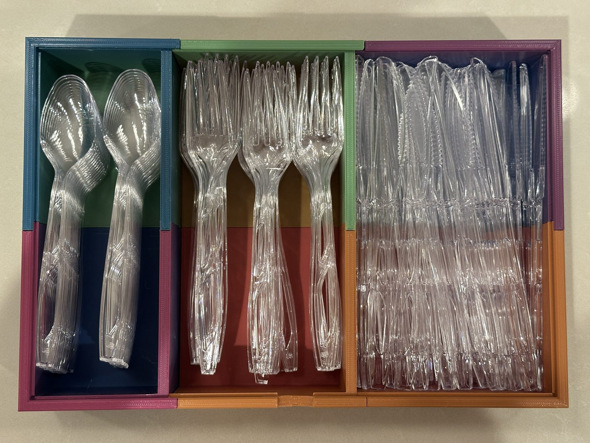
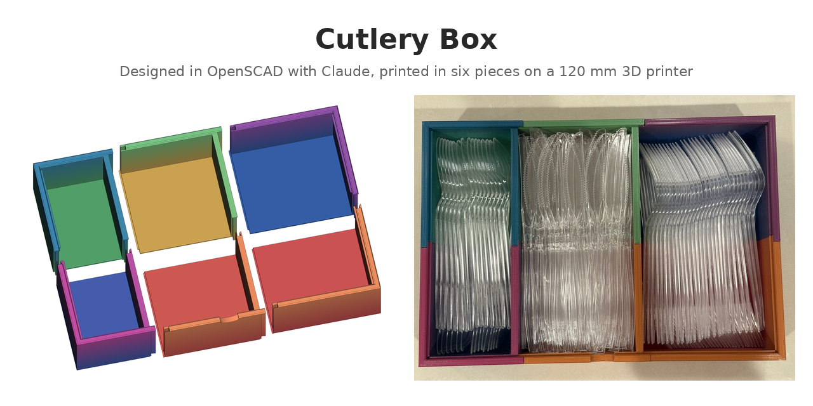
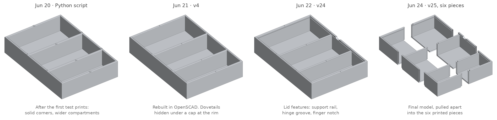
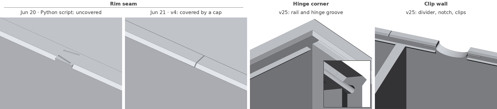
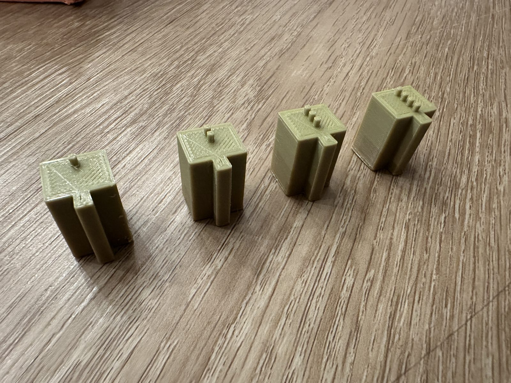
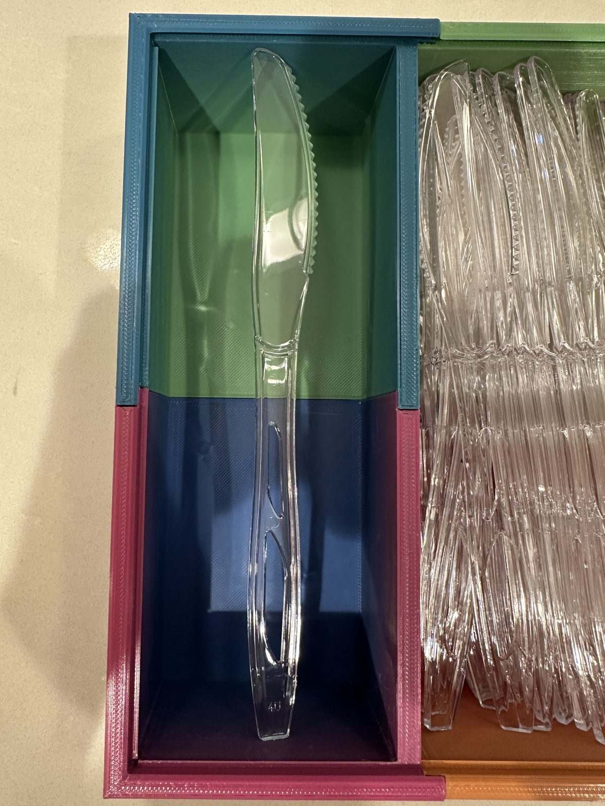

<a id="readme-top"></a>

<div align="center">



# Cutlery Box

**A 3D-printed 3 compartment box for disposable cutlery, designed in OpenSCAD with Claude**

[What it does](#what-it-does) · [How it was made](#how-it-was-made) · [Build log](#build-log)


[](LICENSE)

</div>

<details>
<summary>Contents</summary>

- [Approach](#approach)
- [What it does](#what-it-does)
- [How it was made](#how-it-was-made)
- [Build log](#build-log)
- [Known limitations](#known-limitations)
- [Run it](#run-it)
- [Feedback](#feedback)
- [License](#license)

</details>

A three-compartment box for disposable knives, forks and spoons, designed in OpenSCAD with Claude and printed in six pieces on a small hobby printer.

Disposable cutlery usually comes in cardboard or thin plastic boxes that are disposable themselves: hard to keep sanitized, and not made to last. The organizers I found are designed for real cutlery: they don't hold enough, and none have this flat, side-by-side layout. When my son got a kids' 3D printer, I used its downtime to try a project that had been on my mind for a while. The box had to hold all three types side by side, so it came out far bigger than the printer's 120 mm build area (303 × 208 × 58 mm). It prints as six pieces that slide together on dovetails hidden inside the walls. From outside it reads as one box with nearly straight seams (you can still see and feel them) and a chamfered rim that's comfortable to grab. Six days of design, several rounds of test prints, a Dremel and some glue got it from idea to the kitchen counter, where it's been in use since July 2026. I printed a second one for my brother, who'd been looking for one.



## Approach

I designed this in June 2026 in plain chat sessions with Claude: no text-to-CAD tools, no CAD plugins, no custom workflow. It was a test of how far raw Claude gets on a physical design. It is not the detailed method used in the [devshop](https://github.com/meirmsn/abra-kadabra). I had a clear picture of the box I wanted, so I wasn't asking Claude for ideas: I made the design calls and directed it. Claude wrote the geometry, first as a Python script that wrote meshes directly and then as a parametric OpenSCAD model, and checked the meshes with its own scripts. It couldn't run OpenSCAD itself, so I rendered the parts, checked them in the OpenSCAD viewer and sent screenshots back with feedback, sometimes with the problem circled in red, until the model looked the way I'd pictured it. Then I printed the parts on my son's printer (an AOSEED X-MAKER JOY AI+), photographed what went wrong, and went back to Claude for the next round, until it worked. Without Claude I'd have had to get back up to speed on a CAD program I hadn't used in years, which would have taken more time than I had; with it, I could iterate in minutes.

What the process taught: a model that looks right on screen is not yet a part that prints. Every real problem showed up on a printed test piece, and some only showed up once the box was in daily use.

<p align="right"><small><a href="#readme-top">back to top</a></small></p>

## What it does

- Holds 184 pieces of our usual disposable cutlery (up to about 190 mm long): 48 spoons, 56 forks and 80 knives, one type per compartment
- Assembles into one box with no screws: the joints are hidden inside the walls, leaving only nearly straight seam lines
- Lets you choose how to organize it. The three compartments have different widths and the cutlery has different shapes (a spoon has a big head, a knife is long and slender), so you can decide which type goes where, give the widest compartment to the type you use most, and stack them face up in columns (neat but tippy), pack them on edge like the packaging, or just drop them in loose
- Can be resized: the compartment widths and height are parameters in one file, so in theory you can fit other cutlery or split the width differently (I haven't tried)
- Can be printed on a printer as small as 120 × 120 × 120 mm, with little support material (the throwaway scaffolding printers add under overhangs)

<p align="right"><small><a href="#readme-top">back to top</a></small></p>

## How it was made

- **Cut from one solid.** The OpenSCAD model builds the whole box, rim chamfer included, then cuts it apart with dovetail-shaped blocks. The cuts that split the box are the joints, so the chamfer (the small bevel along the top edge) runs unbroken across every seam.
- **Hidden dovetails behind straight edges.** Vertical sliding dovetails sit inside the 6 mm walls, and a cap covers each joint at the top so the rim shows one straight seam line. Pieces drop in from above.
- **Designed to print without supports.** The undersides of the joint caps slope at 50°, the base seams use 45° wedges, and the few remaining overhangs are meant to be short enough to print in mid-air. In practice my slicer still added a little support under the dovetail tongues, which start just above the floor.
- **Tuned on printed coupons, then finished by hand.** The joint fit was dialled in with coupons (small test pieces) at 0.05–0.20 mm of gap on each side of the joint. Fit still varied from print to print at the same settings, so the final assembly needed a Dremel and plastic glue.
- **Sized from real cutlery, then re-used differently.** Compartments were sized for three face-up columns of each type, from measured cutlery. Those stacks kept falling over, even standing still. Packing the cutlery on edge the way it comes packaged holds 184 pieces instead of 120 and stays put; the most-used type now gets the widest compartment.
- **Tried and dropped:** a Python generator that wrote meshes directly (it couldn't cut one solid cleanly with another), flat base joints (they trapped support material), and a lid (see Known limitations).

<p align="right"><small><a href="#readme-top">back to top</a></small></p>

## Build log

<details>
<summary>Show all 8 entries</summary>

- **2026-06-19:** First model: three compartments, split into a 3 × 2 grid of pieces to fit the printer.
- **2026-06-20:** First test prints. Corners came out hollow and the compartments were too narrow. Re-measured and resized.
- **2026-06-21:** Rebuilt in OpenSCAD, which can cut solids cleanly. Joints hidden under a capped, chamfered rim.
- **2026-06-22:** Lid features added (hinge groove, support rail, clips, finger notch). Trial pieces showed elephant's foot, warped corners, flimsy sockets and trapped support.
- **2026-06-23:** Dovetail fit tuned with graduated test coupons and full-height test tongues. All base joints changed to 45° wedges.
- **2026-06-24:** Final model (v25). Six STLs exported.
- **By 2026-06-30:** All six pieces printed, high spots Dremelled down, box assembled and glued.
- **2026-07-05:** In daily use. Since then the cutlery has moved from face-up columns, which kept falling over, to on edge like the packaging: 184 pieces instead of 120 (+53%).

</details>

**Whole view**


*Six days of versions, rendered from the saved files. The overall shape barely changed; the work happened at the joints and the rim.*

**Detail view**


*Rim seam: in the Python version the dovetail reaches the top of the rim; the two dark slits are the gaps along its slanted sides, and the chamfer is cut through. From v4 a cap covers it, leaving one straight line. Hinge corner: the support rail along the short wall is where the lid would rest. The hinge groove in the long wall is a half-round channel behind an angled opening (inset, seen where the piece is cut), meant to let the lid swing up and also lift right out. Clip wall: the divider is lowered and flat, without the chamfer, so its top is a column for the lid to rest on. The finger notch lets a thumb reach under the lid's edge, and the two small clips beside it are meant to hold the lid shut until it's lifted there.*

**Challenges**

| Joint fit | A longer knife |
|---|---|
|  |  |
| The first dovetails slid in too easily, and tighter ones jammed. On one piece, two joints that were identical in the model fit differently, so the variation came from the printer. Claude and I printed four test coupons at different clearances to find a size that works despite it. The model uses the 2-dot fit; glue, not sanding, did the rest. | A longer knife from another brand touches both end walls of a compartment. Angled slightly in the widest compartment, it fits. |

**[Read the full build log →](docs/BUILD_LOG.md)**: the planning, every test print, what broke, what it taught, and what I'd change next time, with photos and renders.

<p align="right"><small><a href="#readme-top">back to top</a></small></p>

## Known limitations

- The joint fit depends on the printer and varied between prints even at the same settings. Expect to print the test coupons first, and possibly to sand or glue.
- The pieces use up to 118.5 mm of a 120 mm print area. Check your printer's real usable area, and note that widening a compartment will push its pieces past it.
- There's no lid. The rim has a hinge groove, a support rail and clips for a 2 mm clear sheet (196.5 × 290 mm), but I didn't find a food-safe sheet with the right size and finish at a reasonable price and so far haven't needed one. [Suggestions welcome](#feedback).
- The interior is 196 mm long. Our usual disposable cutlery fits, but a longer knife from another brand fits only angled in the widest compartment.
- Compartment widths were chosen for three columns per compartment, not for packing on edge. The split that works for us is in the build log; yours may differ.

<p align="right"><small><a href="#readme-top">back to top</a></small></p>

## Run it

**Print it.** Download the STLs from the [v1.0 release](../../releases/tag/v1.0) (one zip, no cloning), or open any file in [`stl/`](stl/) to preview it in 3D on GitHub.
1. Print the test coupons in [`stl/test-coupons/`](stl/test-coupons/) and slide each into a printed socket. The model uses the 2-dot fit (0.15 mm gap per side). If another coupon fits your printer better, change `DT_NECK` and `DT_FLARE` in the OpenSCAD file and re-export; leave the socket as it is.
2. Print each piece flat on its floor, as oriented. Your slicer may add a little support under the dovetail tongues, which start 3 mm above the floor, and possibly under a joint cap; mine did with support set to "partial". On our printer each piece took 5 h 5 min to 5 h 39 min and 57–68 g of PLA: 32 h 18 min and 382 g for all six. Turn on elephant's-foot compensation in your slicer (about 0.15–0.20 mm; some slicers write it as a negative number).
3. Dry-fit first. Build one half by lowering knife, fork and spoon pieces onto each other, build the other half the same way, then lower one half onto the other. Grind or sand any high spots that stop pieces from seating, then glue for a rigid box (I did).

**Change it.** Open [`scad/cutlery_box.scad`](scad/cutlery_box.scad) in [OpenSCAD](https://openscad.org/), edit the parameters at the top, pick a `part`, render with F6 and export to STL. All six at once:

```bash
for p in knife_A knife_B fork_A fork_B spoon_A spoon_B; do
  openscad -o "stl/body_$p.stl" -D "part=\"$p\"" scad/cutlery_box.scad
done
```

The coupon generators and the renderer used for the images are in [`tools/`](tools/). Everything else from the design process (25 model versions, notes, renders, screenshots) is in [`archive/`](archive/).

<p align="right"><small><a href="#readme-top">back to top</a></small></p>

## Feedback

Suggestions and critiques welcome — open an issue or a discussion.

In particular: if you know an affordable, food-safe clear sheet with a good surface finish that can be cut to about 196.5 × 290 × 2 mm with rounded edges, or a good printable lid design, please open an issue or send me a message.

<p align="right"><small><a href="#readme-top">back to top</a></small></p>

## License

The design files (OpenSCAD source, STLs, photos, renders and docs) are licensed under [CC BY 4.0](LICENSE): you can print, remix and share them, including commercially, as long as you credit [@meirmsn](https://github.com/meirmsn).

<p align="right"><small><a href="#readme-top">back to top</a></small></p>
