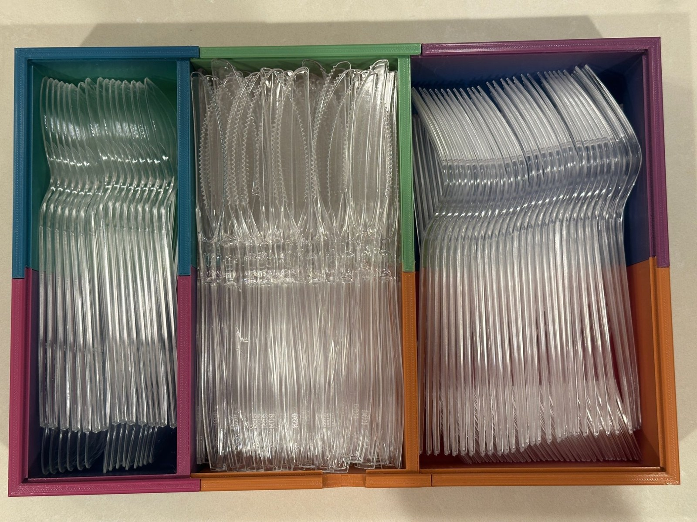
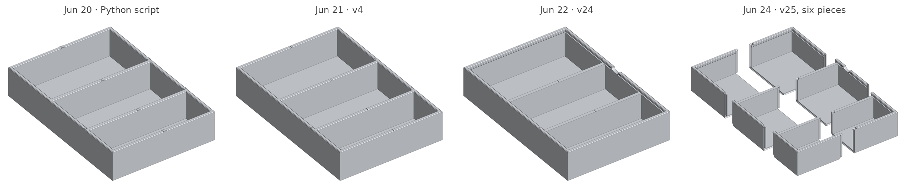
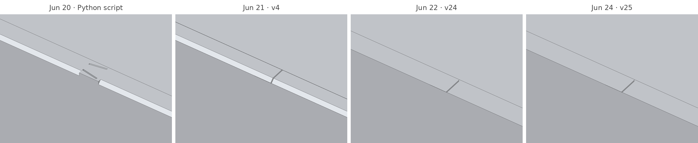
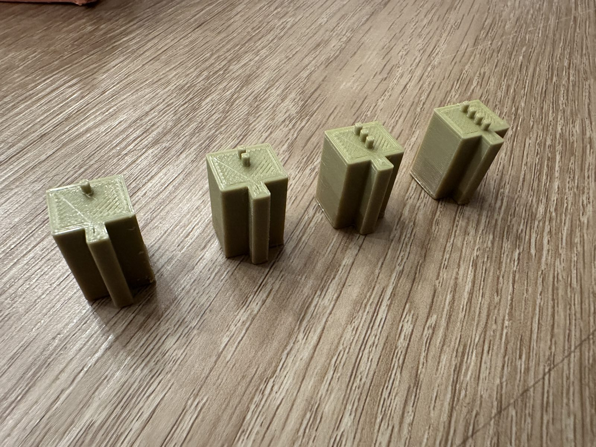
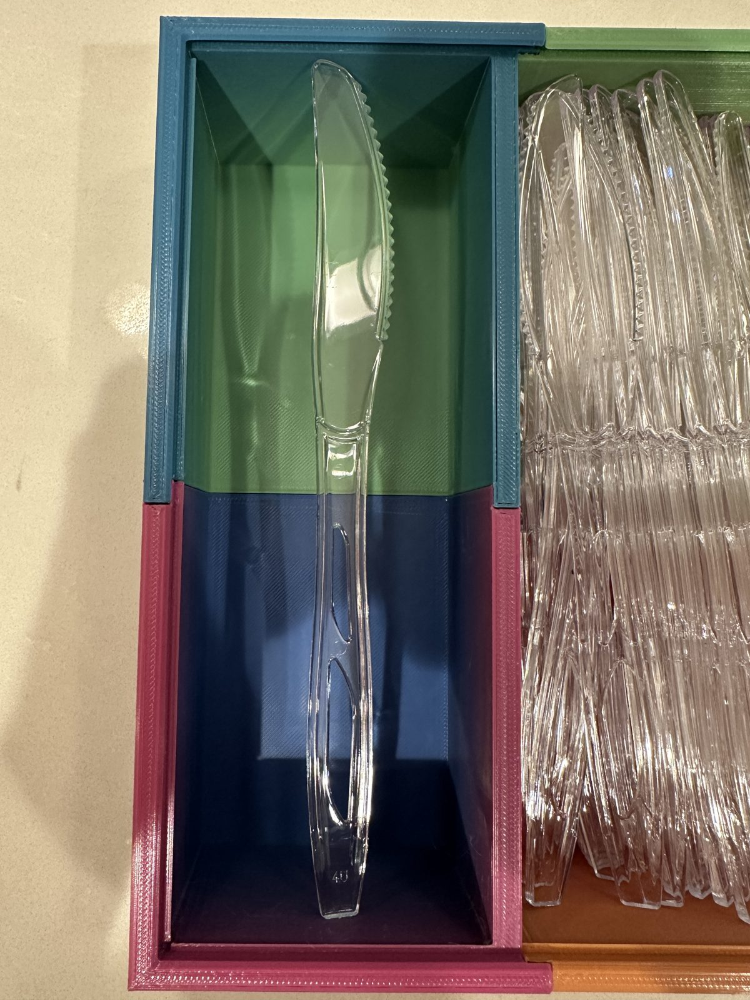

# Cutlery Box

> **Status: Shipped · in daily use** · last touched 2026-11

A three-compartment box for disposable knives, forks and spoons, designed in OpenSCAD with Claude and printed in six pieces on a small hobby printer.

Disposable cutlery usually lives in cardboard boxes that fall apart or plastic ones that crack into sharp pieces, none of them can be washed, and the organizers I found for real cutlery don't hold enough. The box is 303 × 208 × 58 mm, too big for the 120 mm printer it was made on, so it prints as six pieces that slide together on dovetails hidden inside the walls. From outside it reads as one box with straight seams and a chamfered rim that's comfortable to grab. Six days of design, several rounds of test prints, a Dremel and some glue got it from idea to the kitchen counter, where it's been in use since July 2026. I printed a second one for my brother, who'd been looking for one.



## Approach

I designed this in June 2026 in plain chat sessions with Claude: no text-to-CAD tools, no CAD plugins, no custom workflow. It was a test of how far raw Claude gets on a physical design. It is not the detailed method used in the [devshop](https://github.com/meirmsn/abra-kadabra). Claude wrote the geometry, first as a Python script that wrote meshes directly and then as a parametric OpenSCAD model, and checked the meshes with its own scripts. It couldn't run OpenSCAD itself, so I rendered the parts, printed them on my son's printer (an AOSEED X-MAKER JOY AI+), photographed what went wrong, and made the design calls. Human in the loop: @meirmsn; robot hands for packaging this repo: @meirmsn-agent.

What the process taught: a model that looks right on screen is not yet a part that prints. Every real problem showed up on a printed test piece, and some only showed up once the box was in daily use.

## What it does

- Holds 184 pieces of our usual disposable cutlery (up to about 190 mm long): 48 spoons, 56 forks and 80 knives, one type per compartment
- Prints on a small printer with a 120 × 120 × 120 mm build area, with no support material (the throwaway scaffolding printers add under overhangs)
- Assembles into one box with no screws: the joints are hidden inside the walls, leaving only straight seam lines
- Lets you change the compartment sizes and height in one file to fit other cutlery

## How it works

- **Cut from one solid.** The OpenSCAD model builds the whole box, rim chamfer included, then cuts it apart with dovetail-shaped blocks. The cuts that split the box are the joints, so the chamfer (the small bevel along the top edge) runs unbroken across every seam.
- **Hidden dovetails behind straight edges.** Vertical sliding dovetails sit inside the 6 mm walls, and a cap covers each joint at the top so the rim shows one straight seam line. Pieces drop in from above.
- **Printable without supports.** The undersides of the joint caps slope at 50°, the base seams use 45° wedges, and the few remaining overhangs are short enough to print in mid-air.
- **Tuned on printed coupons, then finished by hand.** The joint fit was dialled in with coupons (small test pieces) at 0.05–0.20 mm of gap on each side of the joint. Fit still varied from print to print at the same settings, so the final assembly needed a Dremel and plastic glue.
- **Sized from real cutlery, then re-used differently.** Compartments were sized for three face-up columns of each type, from measured cutlery. Those wobbled when the box was moved. Packing the cutlery on edge the way it comes packaged holds 184 pieces instead of 120 and stays put; the most-used type now gets the widest compartment.
- **Tried and dropped:** a Python generator that wrote meshes directly (it couldn't cut one solid cleanly with another), flat base joints (they trapped support material), and a lid (see Known limitations).

## Build log

- **2026-06-19:** First model: three compartments, split into a 3 × 2 grid of pieces to fit the printer.
- **2026-06-20:** First test prints. Corners came out hollow and the compartments were too narrow. Re-measured and resized.
- **2026-06-21:** Rebuilt in OpenSCAD, which can cut solids cleanly. Joints hidden under a capped, chamfered rim.
- **2026-06-22:** Lid features added (hinge groove, support rail, clips, finger notch). Trial pieces showed elephant's foot, warped corners, flimsy sockets and trapped support.
- **2026-06-23:** Dovetail fit tuned with graduated test coupons and full-height test tongues. All base joints changed to 45° wedges.
- **2026-06-24:** Final model (v25). Six STLs exported.
- **By 2026-06-30:** All six pieces printed, high spots Dremelled down, box assembled and glued.
- **2026-07-05:** In daily use. Since then the cutlery has moved from face-up columns, which wobbled, to on edge like the packaging: 184 pieces instead of 120 (+53%).



*Six days of versions, rendered from the saved files. The overall shape barely changed; the work happened at the joints and the rim. Close up (second row), the dovetail's outline on top of the rim gives way to a cap and one straight seam line.*

| Joint test coupons, one to four dots | A longer knife from another brand: it touches both end walls |
|---|---|
|  |  |

**[Read the full build log →](docs/BUILD_LOG.md)**: the planning, every test print, what broke, what it taught, and what I'd change next time, with photos and renders.

## Known limitations

- The joint fit depends on the printer and varied between prints even at the same settings. Expect to print the test coupons first, and possibly to sand or glue.
- The pieces use up to 118.5 mm of a 120 mm print area. Check your printer's real usable area, and note that widening a compartment will push its pieces past it.
- There's no lid. The rim has a hinge groove, a support rail and clips for a 2 mm clear sheet (196.5 × 290 mm), but I didn't find a food-safe sheet with the right size and finish at a reasonable price and so far haven't needed one. [Suggestions welcome](#feedback).
- The interior is 196 mm long. Our usual disposable cutlery fits, but a longer knife from another brand didn't.
- Compartment widths were chosen for three columns per compartment, not for packing on edge. The split that works for us is in the build log; yours may differ.

## Run it

**Print it.** Download the STLs from the [v1.0 release](../../releases/tag/v1.0) (one zip, no cloning), or open any file in [`stl/`](stl/) to preview it in 3D on GitHub.
1. Print the test coupons in [`stl/test-coupons/`](stl/test-coupons/) and slide each into a printed socket. The model uses the 2-dot fit (0.15 mm gap per side). If another coupon fits your printer better, change `DT_NECK` and `DT_FLARE` in the OpenSCAD file and re-export; leave the socket as it is.
2. Print each piece flat on its floor, as oriented, with no supports. Turn on elephant's-foot compensation in your slicer (about 0.15–0.20 mm; some slicers write it as a negative number).
3. Dry-fit first. Build one half by lowering knife, fork and spoon pieces onto each other, build the other half the same way, then lower one half onto the other. Grind or sand any high spots that stop pieces from seating, then glue for a rigid box (I did).

**Change it.** Open [`scad/cutlery_box.scad`](scad/cutlery_box.scad) in [OpenSCAD](https://openscad.org/), edit the parameters at the top, pick a `part`, render with F6 and export to STL. All six at once:

```bash
for p in knife_A knife_B fork_A fork_B spoon_A spoon_B; do
  openscad -o "stl/body_$p.stl" -D "part=\"$p\"" scad/cutlery_box.scad
done
```

The coupon generators and the renderer used for the images are in [`tools/`](tools/). Everything else from the design process (25 model versions, notes, renders, screenshots) is in [`archive/`](archive/).

## Feedback

Suggestions and critiques welcome — open an issue or a discussion.

In particular: if you know an affordable, food-safe clear sheet with a good surface finish that can be cut to about 196.5 × 290 × 2 mm with rounded edges, or a good printable lid design, please open an issue or send me a message.

## License

The design files (OpenSCAD source, STLs, photos, renders and docs) are licensed under [CC BY 4.0](LICENSE): you can print, remix and share them, including commercially, as long as you credit Meir Messingher Lang.
