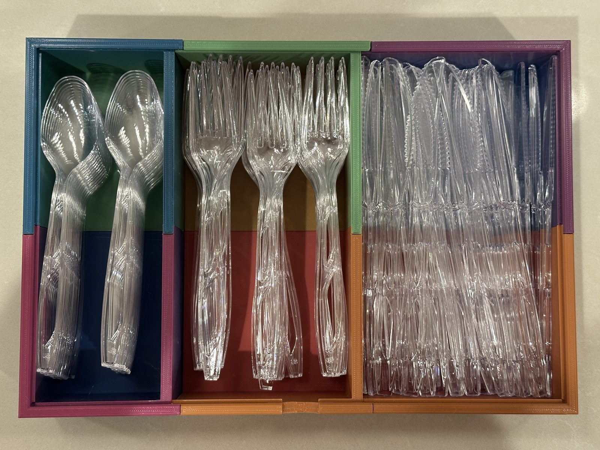

# Build log

How a box for disposable cutlery went from a chat to a six-piece print in daily use, and what that taught. Design dates come from the project files' timestamps (US Pacific time); later dates come from the photos. The close-up photos of test pieces were taken afterwards, of the leftover prints, and are placed where those prints belong in the story.

[← back to README](../README.md)

**Contents:** [Why](#why) · [The plan](#the-plan-june-19) · [First test prints](#first-test-prints-june-20) · [Rebuilding in OpenSCAD](#rebuilding-in-openscad-june-21) · [Trial pieces](#trial-pieces-june-22) · [Fitting the dovetails](#fitting-the-dovetails-june-2324) · [Finishing](#finishing-dremel-and-glue-late-june) · [Living with it](#living-with-it-july-onward) · [What I learned](#what-i-learned) · [Next version](#next-version)

---

## Why

Disposable cutlery needed one place on the counter, with knives, forks and spoons kept apart. My son has a small 3D printer, so the box could be printed rather than bought.

It was also an experiment. In June 2026 I wanted to see how far plain Claude, used in ordinary chat with no add-ons, could take a physical design from idea to printed part. I used no text-to-CAD tools, no CAD plugins and no special workflow. At the time I didn't know that text-to-CAD tools existed.

## The plan (June 19)

**The constraint that shaped everything:** the printer (an AOSEED) builds at most 120 × 120 × 120 mm. Disposable cutlery is about 190 mm long, and a box for three types side by side is about 300 mm wide. It can't print in one piece in either direction.

So the box is cut into a grid: three compartments across, two halves (A and B) along the length, six pieces in all, each small enough for the printer. Neighbouring compartments share one wall to save space, and there are no dividers inside a compartment.

Each compartment was sized for **three columns** of its cutlery type, using measurements of our cutlery plus published sizes:

| | Length | Width | Compartment (3 columns + play) |
|---|---|---|---|
| Knife | 188 mm | 19 mm | 69 mm |
| Fork | 180 mm | 29 mm | 99 mm |
| Spoon | 165 mm | 34 mm | 111 mm |

That makes the compartments different widths, narrowest for knives and widest for spoons. The interior is 196 mm long, enough for a 188 mm knife.

The first version was a Python script, written by Claude, that wrote triangle meshes directly with no CAD software. Every piece is joined to its neighbours by vertical sliding dovetails hidden inside the walls, so you build the box by lowering pieces straight down.

## First test prints (June 20)

Rather than print a whole piece, the first tests were short slices of a piece: enough height to check the corners and the joints.

**Hollow corners.** The corners where the walls meet came out empty, even though they looked solid on screen. The script built each wall as a separate solid, overlapping at the corners, and left it to the slicer to merge them. This slicer treats a region covered twice as *outside*, so every overlap printed as a hole. The fix was walls that meet edge to edge instead of overlapping.

**Too narrow.** The first column widths were too tight: only two knives fit across, not three. The compartments were re-derived from the measurements in the table above.

> **Lesson:** "looks solid on screen" is not "slices solid." And measure the real objects before sizing anything.

## Rebuilding in OpenSCAD (June 21)

The Python script couldn't keep the rim's chamfer (the small bevel along the top edge) continuous where a joint crosses it, because that needs a true cut of one solid by another. So the model was rebuilt in OpenSCAD, which can do that:

1. Build the whole box as a single solid, chamfered rim included.
2. Cut it apart with dovetail-shaped blocks. The same cuts form the joints and split the box into six pieces.

**A defect every check missed.** Two pieces showed a ghost face that another program turned into a solid block halfway up the wall. All the standard mesh checks passed. The cause was a cut plane lying exactly on an existing wall face, which leaves behind a sheet of zero thickness. Moving those cut planes 0.02 mm into open space fixed it.

**Straight edges on top.** The trapezoid of each dovetail showed on the top of the rim. Now the male piece carries a cap the full width of the wall and the female piece has a matching recess, so the rim shows one straight seam and the joint sits underneath. The cap's underside slopes at 50° so it prints without support.

The overall shape barely changed from here to the final version; nearly all the later work was at the joints:

## Trial pieces (June 22)

The top of the box gained features for a flat clear lid: a hinge groove along one long wall, a lipped support rail, two light clips, and a finger notch to lift it.

Then came the first trial pieces, with four problems. The annotations are from that day.

| Problem | Cause | Fix |
|---|---|---|
| Base corners splaying outward | Elephant's foot: the first layers squash out | Slicer settings: 0.15–0.20 mm elephant's-foot compensation, slightly less plastic on the first layer, cooler bed after it |
| Dovetail socket flimsy, and visible from outside | Only 0.5 mm of wall each side of the socket, about one line of extruded plastic | Smaller dovetail and tighter clearance: 1.0 mm of wall each side |
| Support material stuck under the base joints | The flat overlapping base joint left a floating lip that needed support inside a pocket | All base joints changed to 45° wedges, which need no support |
| Thin tab dangling where two seams cross | Two overlapping joints at the same corner | A solid full-height corner on one of the two pieces |

| Elephant's foot | Socket visible from outside |
|---|---|
|  |  |
| **Support stuck in a base joint** | **Dangling tab at a seam corner** |
|  |  |

**Warping.** Some pieces also lifted at the corners, the bottom curling up off the bed:

## Fitting the dovetails (June 23–24)

This took the most rounds. The first joints slid in but wobbled and pulled back out. Making them tighter fixed one print and jammed the next: sometimes there was good friction and sometimes none, from prints that should have been identical.

The approach that worked was to stop changing both sides at once. The female socket, once it printed well, was frozen. The male side (the tongue) was tested on its own against the female side (the socket), with four coupons (small test pieces) at 0.20, 0.15, 0.10 and 0.05 mm clearance per side, each marked with one to four dots so they could be told apart off the bed.

| The four coupons | Testing one in a printed socket |
|---|---|
|  |  |

Then two full-height tongues with the real top cap checked the fit over the whole 55 mm:

The final model (v25, June 24) uses 0.15 mm per side.

 Coupon files: [`stl/test-coupons/`](../stl/test-coupons/). Generators: [`tools/`](../tools/).

> **Lesson:** the printer's precision, and its repeatability from one print to the next, is a design input. A fit that works on one print may not on the next, even at identical settings. Test on cheap coupons, change one side of a joint at a time, and plan for some hand fitting.

## Finishing: Dremel and glue (late June)

With all six pieces printed, they still didn't sit flush. High spots on the mating faces bumped into each other and kept the pieces from seating. A Dremel took those down.

Even seated, the friction fit wasn't enough for a box that gets picked up and moved. Plastic glue on the joints made it one rigid unit that doesn't wobble at rest.

## Living with it (July onward)

**A knife that didn't fit.** Our usual brand fits well within the 196 mm interior. But one particularly long knife from another brand touched both ends. The sizing came from our own measurements plus published sizes, and the outlier wasn't covered.

**Columns didn't work in practice.** The box was designed for three columns per compartment. In use, the cutlery slid around whenever the box was moved. Nesting the pieces flat in stacks, the way they come in the package, fixed it: the box held **more** (I haven't counted how much yet) and stopped shifting. Packaging is presumably already optimised for space, so copying it was the better layout.

**Re-assigning the compartments.** With stacking, compartment width matters differently. The widest compartments hold the most, so the types moved: spoons, which we use least, went into the narrowest compartment (designed for knives). Forks are in the middle and knives in the widest.

Open question: forks are what we use most, so they may belong in the widest compartment, with knives in the middle. Whether that's better also depends on how easy each type is to grab out of its compartment.

**No lid, so far.** The rim has everything a clear 2 mm lid needs, but the food-safe sheets I found were expensive or not good enough, and we haven't missed a lid. If you know a good source, please [open an issue](../README.md#feedback).

## What I learned

- **The screen lies in specific ways.** Hollow corners, ghost faces and visible seams all looked fine on screen. A short slice of a piece is the cheapest test there is.
- **Printer variance is part of the design.** Clearances that worked on one print failed on the next. Coupons narrow the range; a Dremel and glue close the gap.
- **Change one variable at a time.** Freezing the socket and testing only the male side is what finally made progress on the joint.
- **Measure the full range, not one sample.** One long knife from another brand was enough to miss.
- **Use reveals what planning can't.** The layout that works (nested stacks), the capacity, and which compartment should hold which type only became clear once the box was on the counter.
- **Plain Claude got a working design,** with a lot of human rendering, printing and judging in the loop. It couldn't run OpenSCAD or touch the prints: I rendered, printed and photographed, and it worked from my screenshots and its own diagrams.

## Next version

- **Try text-to-CAD and other CAD tools for language models,** and compare against this plain-chat baseline: how many rounds, how many test prints, and how good the result is.
- **Design for stacks from the start:** size the compartments for nested cutlery and for how often each type is used, and check how easy each is to grab.
- **Measure several brands,** including the longest knife likely to end up in the box.
- **Design the joints for glue,** or for a looser fit that tolerates print-to-print variation, rather than relying on a precise friction fit.
- **A lid:** find an affordable food-safe sheet, or design a printable one.

---

Raw notes, all 25 model versions and every design screenshot are in [`../archive/`](../archive/).
